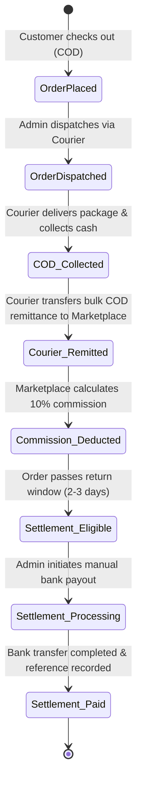

# MAKAURA BEAUTY BRAND MULTI-VENDOR MARKETPLACE
## System Architecture & Technical Specification

> **Version**: 1.0.0 (Phase 1 Foundation)  
> **Target Environment**: Windows Development & Ubuntu Contabo VPS Production  
> **Core Concept**: Luxury Multi-Vendor Beauty Brand Marketplace (LAAM / Sephora inspired)

---

## 1. High-Level Architecture Overview

Makaura is designed as an enterprise-grade, monorepo multi-vendor beauty marketplace platform. It decouples the customer-facing luxury storefront and administration portals (**Next.js**) from the mission-critical business logic, RBAC, and financial ledger services (**NestJS REST API**).

```mermaid
graph TD
    subgraph Clients["Frontend Clients (Next.js 14)"]
        CustomerUI["Customer Storefront (/shop, /categories, /cart)"]
        BrandPortal["Brand Owner Dashboard (/brand/*)"]
        AdminPortal["Marketplace Admin Panel (/admin/*)"]
    end

    subgraph ReverseProxy["Edge & Ingress"]
        Nginx["Nginx Reverse Proxy (SSL, Gzip, Rate Limiting)"]
    end

    subgraph BackendAPI["Backend Service (NestJS REST API)"]
        AuthModule["Auth & RBAC Module (JWT, Guards)"]
        HealthModule["Health & System Monitoring"]
        OrdersModule["Orders & Sub-Order Splitter"]
        CODModule["COD & Courier Remittance Service"]
        SettlementModule["Commission & Settlement Ledger"]
        StorageService["Storage Driver Abstraction (Local / S3 / MinIO)"]
    end

    subgraph DataStore["Data & Asynchronous Layer"]
        Postgres[(PostgreSQL 16/17 - Relational DB & Ledger)]
        Redis[(Redis 7/8 - BullMQ Queues & Fast Cache)]
    end

    CustomerUI -->|HTTP / HTTPS| Nginx
    BrandPortal -->|HTTP / HTTPS| Nginx
    AdminPortal -->|HTTP / HTTPS| Nginx

    Nginx -->|Proxy Pass :3000| CustomerUI
    Nginx -->|Proxy Pass :4000/api| BackendAPI

    BackendAPI -->|Prisma ORM (Connection Pool)| Postgres
    BackendAPI -->|BullMQ Jobs / Caching| Redis
```

---

## 2. Monorepo Organization

The project is structured as an npm workspaces monorepo:

```
makaura/
├── apps/
│   ├── web/                    # Next.js 14 App Router (Customer, Brand & Admin Frontends)
│   │   ├── src/
│   │   │   ├── app/            # App Router pages and layouts
│   │   │   │   ├── globals.css # Pure CSS Luxury Design System (Zero Tailwind)
│   │   │   │   ├── layout.tsx  # Root HTML layout with SEO metadata & fonts
│   │   │   │   └── page.tsx    # Home page with live health indicator
│   │   │   ├── components/     # Reusable UI components (Header, Footer, BackendStatus)
│   │   ├── Dockerfile          # Multi-stage production container for Next.js
│   │   ├── next.config.js      # Standalone build output for VPS
│   │   └── package.json
│   │
│   └── api/                    # NestJS REST API Backend
│       ├── prisma/
│       │   └── schema.prisma   # PostgreSQL database schema & migrations
│       ├── src/
│       │   ├── common/         # Global filters, interceptors, guards
│       │   ├── config/         # Environment variable configuration & validation
│       │   ├── health/         # Infrastructure health probes (DB, Redis, RAM)
│       │   ├── prisma/         # PrismaService with resilient database ping
│       │   ├── app.module.ts   # Root dependency injection module
│       │   └── main.ts         # Server bootstrap, Swagger, CORS, validation
│       ├── Dockerfile          # Multi-stage production container for NestJS
│       └── package.json
│
├── packages/
│   └── shared/                 # Shared TypeScript models, enums & constants
│       ├── src/
│       │   ├── enums/          # UserRole, BrandStatus, CodStatus, SettlementStatus
│       │   ├── types/          # DTOs, API responses, health status contracts
│       │   ├── constants/      # Currency symbols, upload limits, pagination rules
│       │   └── index.ts
│       └── package.json
│
├── infrastructure/             # Containerization & VPS deployment files
│   ├── docker-compose.yml      # Local dev services (PostgreSQL 16, Redis 7)
│   ├── docker-compose.prod.yml # Complete VPS orchestration (Web, API, DB, Redis, Nginx)
│   └── nginx/                  # Production Nginx reverse proxy configuration
│       ├── nginx.conf
│       └── conf.d/default.conf
│
├── docs/                       # Architectural documentation & technical designs
│   ├── ARCHITECTURE.md         # This specification document
│   ├── DATABASE_DESIGN.md      # Normalized schema & financial rules
│   └── DEVELOPMENT_ROADMAP.md  # 8-Phase implementation milestones
│
├── .env.example                # Root environment template
├── .gitignore                  # Git ignore rules for node, next, prisma, uploads
└── package.json                # Root monorepo workspace definition
```

---

## 3. Multi-Brand Order Architecture

In a multi-vendor marketplace, a customer checkout may contain products from several independent brands.

### Order Splitting Workflow

```
Customer Basket:
├── Brand A: Radiance Vitamin C Serum (Qty: 2) -> Rs. 5,000
├── Brand B: Matte Velvet Lipstick (Qty: 1)     -> Rs. 2,200
└── Brand C: Oud Eau De Parfum (Qty: 1)        -> Rs. 8,500
                                Total Order: Rs. 15,700
```

1. **Parent Order Creation**:
   - Single customer-facing order entity created with unified tracking number (`ORD-XXXXX`).
   - Payment method assigned strictly as `COD` (Cash on Delivery).
   - Order total accurately calculates subtotal, allocated delivery fees, and discount vouchers.
2. **Seller Sub-Orders Decomposition**:
   - The backend creates distinct `SellerOrder` records for each vendor (`SO-A-XXXXX`, `SO-B-XXXXX`, `SO-C-XXXXX`).
   - Each `SellerOrder` contains only that brand's items, its subtotal, commission deduction calculation, and fulfillment lifecycle.
3. **Isolation Guarantees**:
   - Brand A can **only** query and fulfill `SO-A-XXXXX`.
   - Brand B cannot view Brand A's customer details, items, or revenue.
   - Marketplace Administrator has holistic visibility over the parent order and all corresponding sub-orders.

---

## 4. Cash on Delivery (COD) & Settlement Financial State Machine

Unlike payment gateway transactions where cash is captured instantly, COD requires a multi-step remittance and reconciliation pipeline.



### Critical Financial Rules:
1. **Never Float**: All monetary calculations use `Decimal(10, 2)` or `Decimal(12, 2)` types in PostgreSQL and Prisma. Floating-point calculations (`0.1 + 0.2`) are strictly prohibited in the codebase.
2. **Remittance Before Settlement**: Brand payout countdowns **never** start at order placement or delivery. They only initiate once the courier company confirms and transfers the cash remittance to the marketplace bank account.
3. **Audit Trail**: Every financial transition (COD reconciliation, commission deduction, manual bank transfer reference) creates an immutable record in `audit_logs` and `settlement_items`.

---

## 5. Storage Service Abstraction

Product images, brand logos, CNIC verification documents, and bank proofs require secure file handling.

```typescript
export interface IStorageService {
  uploadFile(file: Express.Multer.File, directory: string): Promise<{ key: string; publicUrl: string }>;
  getFileUrl(key: string): Promise<string>;
  deleteFile(key: string): Promise<boolean>;
}
```

- **Local Driver (`LocalStorageService`)**: Saves to `./uploads/` with public serving on `http://localhost:4000/uploads/` during local development.
- **S3 / MinIO Driver (`S3StorageService`)**: Configured via environment variables (`STORAGE_DRIVER=s3`) without rewriting controllers or business modules when deploying to Contabo VPS.

---

## 6. Contabo VPS Deployment & Security Strategy

The production deployment runs via Docker Compose on an Ubuntu LTS VPS:

1. **Network Isolation**:
   - `makaura-backend-net` is an internal Docker network inaccessible to the public internet (PostgreSQL and Redis are not exposed publicly).
   - Only `Nginx` listens on ports `80` and `443`.
2. **SSL / TLS**:
   - Managed via Certbot with automatic ACME challenge renewal mounted to `/var/www/certbot`.
3. **Environment Secrets**:
   - Secrets (`JWT_ACCESS_SECRET`, `POSTGRES_PASSWORD`, etc.) are injected via VPS server environment files or CI/CD pipelines, never committed to git.
4. **Resilience**:
   - Backend health endpoints (`/api/v1/health/live` and `/api/v1/health/ready`) allow Nginx and Docker healthchecks to restart unhealthy containers automatically.
