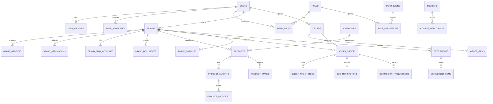

# MAKAURA BEAUTY BRAND MULTI-VENDOR MARKETPLACE
## Comprehensive PostgreSQL Database Design & Schema Specification

> **Database Engine**: PostgreSQL 16 & 17 compatible (Local Windows: 17.7; Docker/VPS: `postgres:17-alpine`)  
> **ORM**: Prisma ORM  
> **Monetary Standard**: `Decimal(12, 2)` (Strictly zero floating-point math)

---

## 1. Entity-Relationship Overview

---

## 2. Table-by-Table Architectural Specifications

### 2.1 Identity, Authentication & RBAC

| Table | Primary Key | Key Columns | Purpose |
| :--- | :--- | :--- | :--- |
| `users` | `id` (UUID) | `email`, `password_hash`, `role`, `is_active` | Core credentials for Customers, Brand Owners, and Admins |
| `user_profiles` | `id` (UUID) | `user_id`, `avatar_url`, `bio`, `gender` | Extended personal profile details |
| `user_addresses` | `id` (UUID) | `user_id`, `recipient_name`, `phone`, `street_address`, `city` | Shipping & Billing addresses for COD deliveries |
| `roles` | `id` (UUID) | `name`, `description`, `is_system` | RBAC roles (`SUPER_ADMIN`, `ADMIN`, `BRAND_OWNER`, etc.) |
| `permissions` | `id` (UUID) | `name`, `module`, `description` | Granular capability definitions (e.g., `brands:approve`) |
| `role_permissions`| `(role_id, permission_id)` | `assigned_at` | Composite junction linking permissions to roles |
| `user_roles` | `(user_id, role_id)` | `assigned_at` | Composite junction assigning roles to users |

---

### 2.2 Brand Onboarding, Governance & Banking

| Table | Primary Key | Key Columns | Purpose |
| :--- | :--- | :--- | :--- |
| `brands` | `id` (UUID) | `name`, `slug`, `status`, `owner_id`, `commission_rate` | Public brand profile and operational state |
| `brand_members` | `id` (UUID) | `brand_id`, `user_id`, `role` | Staff and managers authorized to operate brand dashboard |
| `brand_applications` | `id` (UUID) | `brand_id`, `submitted_by`, `status`, `reviewed_by` | Workflow queue for admin approval/rejection |
| `brand_bank_accounts` | `id` (UUID) | `brand_id`, `bank_name`, `account_number`, `iban`, `is_verified` | Verified destination accounts for manual payouts |
| `brand_documents` | `id` (UUID) | `brand_id`, `document_type`, `file_key`, `is_verified` | Stored business licenses, CNICs, and NTN certificates |

---

### 2.3 Product Catalog & Inventory

| Table | Primary Key | Key Columns | Purpose |
| :--- | :--- | :--- | :--- |
| `categories` | `id` (UUID) | `name`, `slug`, `parent_id`, `icon_url` | Hierarchical beauty taxonomy (e.g. Skincare -> Serums) |
| `collections` | `id` (UUID) | `brand_id`, `title`, `slug`, `banner_url` | Curated product groupings (e.g. Summer Glow, Bridal) |
| `products` | `id` (UUID) | `brand_id`, `title`, `slug`, `status`, `base_price` | Core master product definition |
| `product_variants`| `id` (UUID) | `product_id`, `sku`, `price`, `sale_price`, `shade/size` | Sellable SKUs with variant attributes |
| `product_images` | `id` (UUID) | `product_id`, `variant_id`, `url`, `display_order` | Multi-angle product imagery |
| `product_inventory`| `id` (UUID) | `variant_id`, `quantity`, `reserved_quantity` | Strict stock tracking with transaction locks |
| `product_reviews` | `id` (UUID) | `product_id`, `user_id`, `order_id`, `rating`, `comment` | Purchase-verified customer reviews |

---

### 2.4 Cart, Wishlist & Order Decomposition

| Table | Primary Key | Key Columns | Purpose |
| :--- | :--- | :--- | :--- |
| `carts` | `id` (UUID) | `user_id`, `session_token`, `updated_at` | Persistent shopping basket |
| `cart_items` | `id` (UUID) | `cart_id`, `variant_id`, `quantity` | Individual items in customer cart |
| `orders` | `id` (UUID) | `order_number`, `user_id`, `total_amount`, `payment_method` | Unified parent customer order |
| `order_items` | `id` (UUID) | `order_id`, `variant_id`, `price`, `quantity` | All customer-purchased items across all brands |
| `seller_orders` | `id` (UUID) | `seller_order_number`, `parent_order_id`, `brand_id`, `status` | Sub-order routed specifically to Brand Owner |
| `seller_order_items`| `id` (UUID)| `seller_order_id`, `order_item_id`, `unit_price`, `quantity` | Sub-order line items for brand fulfillment |

---

### 2.5 Cash on Delivery (COD) & Settlement Engine

| Table | Primary Key | Key Columns | Purpose |
| :--- | :--- | :--- | :--- |
| `couriers` | `id` (UUID) | `name`, `code`, `api_endpoint`, `tracking_url_template` | Integrated courier companies (TCS, Leopards, Trax, etc.) |
| `shipments` | `id` (UUID) | `seller_order_id`, `courier_id`, `tracking_number`, `status` | Physical consignment tracking |
| `cod_transactions`| `id` (UUID) | `seller_order_id`, `amount_collected`, `cod_status` | Status of physical cash collected at customer doorstep |
| `courier_remittances`| `id` (UUID)| `courier_id`, `reference_no`, `total_amount`, `remitted_at` | Bulk cash transfers made by courier to Marketplace |
| `commission_transactions`| `id` (UUID)| `seller_order_id`, `rate_percent`, `commission_amount` | Recorded marketplace commission deductions |
| `brand_earnings` | `id` (UUID) | `brand_id`, `seller_order_id`, `payable_amount`, `is_settled` | Brand net payable balance ledger |
| `settlements` | `id` (UUID) | `settlement_number`, `brand_id`, `amount`, `status`, `bank_ref` | Official payout records created by Admin |
| `settlement_items`| `id` (UUID)| `settlement_id`, `seller_order_id`, `allocated_amount` | Itemized seller orders included in a payout |

---

### 2.6 Audit & Governance

| Table | Primary Key | Key Columns | Purpose |
| :--- | :--- | :--- | :--- |
| `audit_logs` | `id` (UUID) | `user_id`, `brand_id`, `action`, `entity`, `metadata` | Immutable audit trail for financial & admin operations |
| `system_settings` | `id` (UUID) | `key`, `value`, `description`, `is_public` | Configurable system-wide parameters |

---

## 3. Financial Integrity & Calculation Precision

### Precision Standards
- All currency balances, line-item totals, shipping fees, commission amounts, and payouts use PostgreSQL `DECIMAL(12, 2)` or `NUMERIC(12, 2)`.
- **Prohibition of JavaScript Floats**: Financial arithmetic on the server is handled using integer cents or Decimal arithmetic libraries (`decimal.js` or Prisma's native `Prisma.Decimal`).

### Mathematical Relationship
For any `SellerOrder` line:
$$\text{Gross Item Subtotal} = \sum (\text{unit\_price} \times \text{quantity})$$
$$\text{Marketplace Commission} = \text{Gross Item Subtotal} \times \left(\frac{\text{Brand Commission Rate}}{100}\right)$$
$$\text{Brand Net Payable} = \text{Gross Item Subtotal} - \text{Marketplace Commission}$$

---

## 4. Performance & Indexing Strategy

1. **Foreign Key Indexes**: Every foreign key column (`user_id`, `brand_id`, `order_id`, `seller_order_id`) is indexed to prevent full-table scans during relational joins.
2. **Slug Lookups**: Unique indexes on `brands(slug)`, `products(slug)`, and `categories(slug)` ensure instant storefront URL resolution.
3. **Status Queries**: Composite indexes on `seller_orders(brand_id, status)` and `orders(user_id, created_at DESC)` ensure fast dashboard load times.
4. **Audit Querying**: Indexed `audit_logs(entity, entity_id)` and `audit_logs(created_at DESC)` for compliance auditing.
